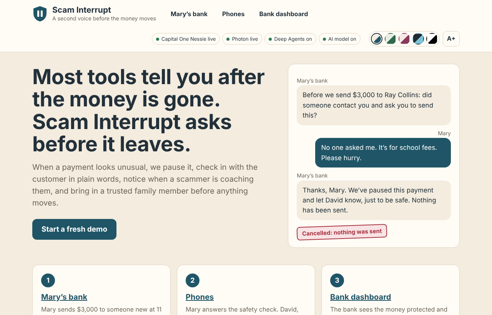
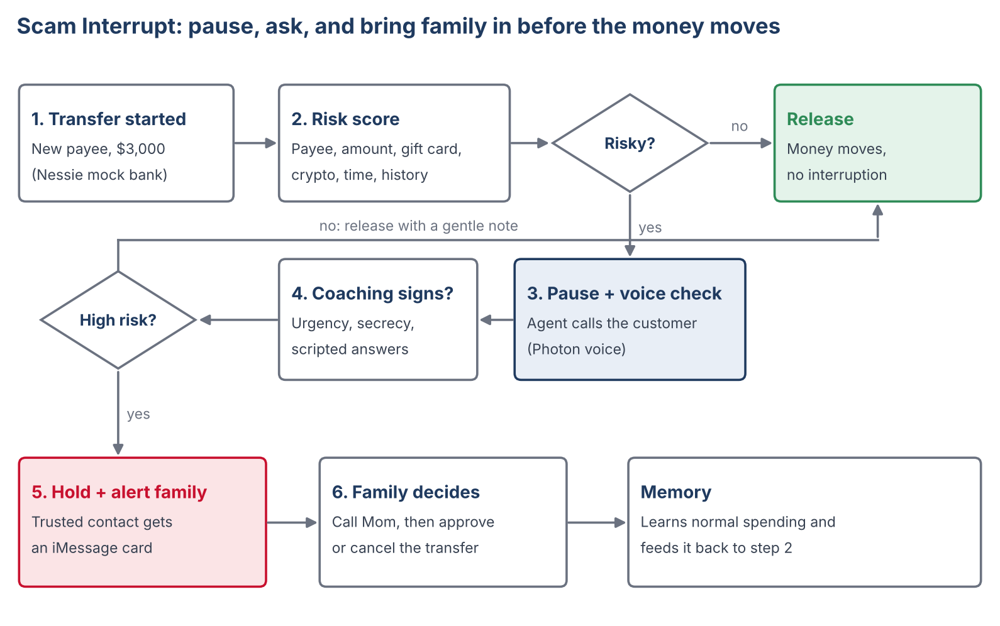
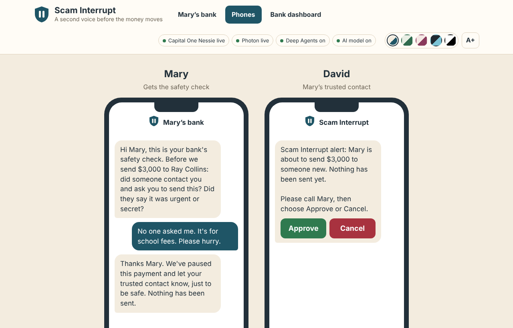
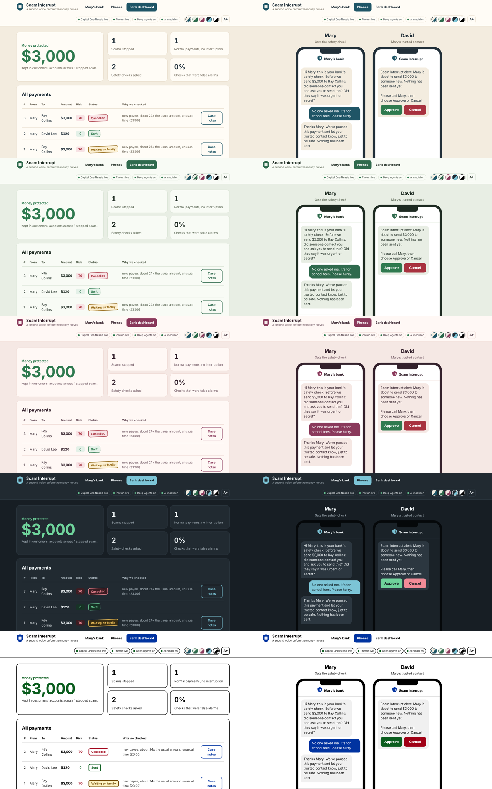
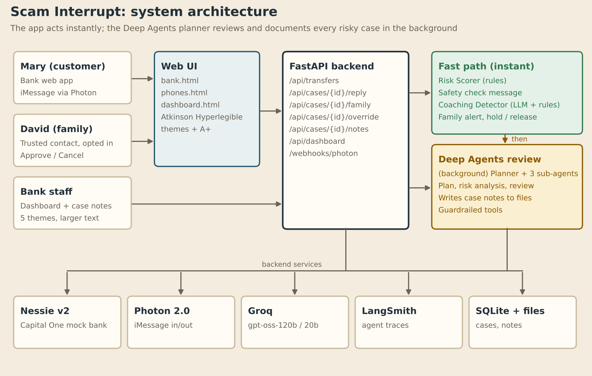

<p align="center"></p>

<h1 align="center">Scam Interrupt</h1>
<p align="center"><b>A second voice before the money moves.</b><br>
Most tools tell you after the money is gone. Scam Interrupt asks before it leaves.</p>

<p align="center"></p>

Scam Interrupt is an AI agent that **pauses risky bank transfers**, checks in with the customer in plain
words, **catches signs that a scammer is coaching them**, and brings an opted-in **trusted family member**
in before anything moves. Normal payments go straight through, and the customer always keeps the final say.

Built at **HackPrinceton Fall 2026** by Keerthana and Gayatri · Main track: **Business and Enterprise**

> **Starter scaffold note:** this repository began from an AI-generated starter scaffold. All project work
> happened during HackPrinceton (Nov 13–15, 2026); see the commit history.

---

## Contents
[The problem](#the-problem) · [What it does](#what-it-does) · [Screens](#screens) ·
[Architecture](#architecture) · [How the agent works](#how-the-agent-works) · [Tech stack](#tech-stack) ·
[Sponsor tools](#sponsor-tools) · [Design and accessibility](#design-and-accessibility) ·
[Run it](#run-it) · [Configuration](#configuration) · [API](#api) · [Project layout](#project-layout) ·
[Tests](#tests) · [Demo script](#demo-script) · [Troubleshooting](#troubleshooting) ·
[Challenges and what we learned](#challenges-and-what-we-learned) · [Privacy and safety](#privacy-and-safety) · [Team](#team)

---

## The problem
Scammers create panic ("your grandson is in jail," "your account is hacked"), then **coach their victims,
often older adults, on exactly what to tell the bank**. Bank fraud checks ask yes/no questions the victim has
already been told how to answer, and most protection tools alert family only **after** the money is gone.

## What it does
**Grandma Mary's story**, which is also our live demo:

1. A scammer texts Mary pretending to be her grandson, needing $3,000 for bail, and says to keep it secret.
2. Mary sends $3,000 in her bank app. **Scam Interrupt holds it. Nothing is sent to the bank yet.**
3. **Risk Scorer:** new payee, about 24× her usual amount, 11 PM → high risk, with reasons.
4. **Safety check** (iMessage via Photon): *"Did someone contact you and ask you to send this? Did they say it
   was urgent or secret?"* Coached, Mary replies: *"No one asked me. It's for school fees. Please hurry."*
5. **Coaching Detector** (AI model + rules): urgency, defensive denial, a scam story → hold.
6. **Family alert:** David, her opted-in trusted contact, gets **Approve** / **Cancel**.
7. David calls Mary and taps **Cancel**. The transfer **never reaches Capital One Nessie**.
8. Mary can still tap **Send anyway**: the customer keeps the final say.
9. In the background, the **Deep Agents** planner reviews the case and writes plain-English **case notes**
   for the bank. The dashboard shows **"Money protected: $3,000."**

A normal $120 payment to David at 2 PM goes straight through with no messages, and Nessie returns a real
transaction id. The cancelled $3,000 has none, which proves the scam payment never reached the bank.

<p align="center"></p>

## Screens

| Mary's bank | Phones (Mary and David) |
|---|---|
|  |  |
| **Bank dashboard** | **Agent case notes** |
|  |  |

**Five themes plus larger text** (Sand, Sage, Bloom, Dusk, High contrast):

<p align="center"></p>

## Architecture

<p align="center"></p>

- **Web UI** (plain HTML, CSS, JavaScript): Mary's bank app, the two phones, and the bank dashboard.
- **FastAPI backend:** receives transfers, safety-check replies, and family decisions, and serves the
  dashboard and case notes. Photon delivers real phone replies to `POST /webhooks/photon`.
- **Fast path (instant):** the proven pipeline makes every customer-facing decision in about a second, so Mary
  and David never wait on a slow model.
- **Deep Agents review (background):** after each step, a LangChain Deep Agents planner reviews the case with
  its sub-agents and writes case notes. Only one review runs at a time, so we stay within rate limits.
- **Backend services:** Capital One Nessie v2 (accounts and transfers), Photon 2.0 (iMessage), Groq (models),
  LangSmith (agent traces), and SQLite plus files (cases and notes).

**The key design rule:** our app holds every risky transfer and only posts it to Nessie after it's approved.
Nessie never sees a scam payment that was cancelled.

## How the agent works

<p align="center"></p>

- **Planner:** gets one event (`transfer_scored` or `customer_replied`), writes a short plan
  (`record_plan` / `write_todos`), reads the customer's profile and the case notes from its file system, and
  delegates to sub-agents with the built-in `task` tool.
- **Sub-agents:**
  - **risk-analyst** explains why the transfer is risky compared with the customer's normal habits, quoting
    the stored signals.
  - **coaching-detector** runs or reviews the coaching verdict (urgency, secrecy, defensive denial, scam stories).
  - **family-messenger** writes a short, calm alert for the trusted contact.
- **Case notebook (real files):** `data/agent_fs/customers/<id>/profile.md` and
  `data/agent_fs/cases/<id>/notes.md`. Agents add sections with `append_note`, which keeps them in order and
  skips duplicates: Plan → Risk analysis → Safety check → Family alert → Agent review → Outcome.
  See [`docs/sample_case_notes.md`](docs/sample_case_notes.md).
- **Guardrails:** money-moving tools refuse unsafe calls. The agent can't release a transfer while the family
  is deciding, can't alert family before a coached verdict, and can't release a high-risk transfer without a
  passed safety check.
- **Two modes:** `AGENT_BACKGROUND=true` (default) acts instantly and runs the agent as a background
  reviewer; `AGENT_BACKGROUND=false` lets the planner make the decisions itself (slower).
- **Traces:** every run appears in LangSmith as `scam-interrupt:<event>-review`.

## Tech stack

**Backend.** Python 3 with **FastAPI** and **Uvicorn** for the web server, **SQLite** for customers,
transfers, safety checks, alerts, habits and messages, and **requests** for calling external APIs.
Configuration comes from a `.env` file through python-dotenv.

**AI and agents.** **LangChain** with the **Deep Agents** library (`deepagents`, built on LangGraph) for
the planner, sub-agents, planning and file system. Models run on **Groq**: `openai/gpt-oss-120b` for the
Coaching Detector and `openai/gpt-oss-20b` for the planner, so each uses its own quota. The Coaching
Detector asks the model for JSON and always keeps a **rule-based safety net**, so the demo works even if the
model is slow or unavailable. **LangSmith** records every agent run as a trace.

**Banking.** **Capital One Nessie v2**: Bearer-token auth, amounts in cents, and `POST /data/seed` for a
ready-made demo bank. An offline **mock Nessie** with the same interface lets us build and demo without Wi-Fi.

**Messaging.** **Photon 2.0** sends the safety check and the family alert as iMessages and delivers replies
to our webhook (exposed with a tunnel such as ngrok during development). An on-screen **phone simulator**
mirrors every message.

**Frontend.** Plain **HTML, CSS and JavaScript**, with no build step. Themes use CSS variables; the font is
**Atkinson Hyperlegible**; preferences are remembered in the browser.

**Testing and tooling.** Offline tests with the mock bank, a simulated Nessie v2 server, and a fake agent.
We built with **Claude Code**, connected to **ChatOverflow** so our coding agents shared what they learned.

## Sponsor tools

| Sponsor | How we use it |
|---|---|
| **Capital One Nessie** | Accounts, transfers and merchants feed the risk score; a held transfer is posted to Nessie only after approval |
| **Photon 2.0** | The customer safety check and the family Approve/Cancel alert run over iMessage |
| **LangChain Deep Agents** | Planner, three sub-agents, planning tool, file-system case notebook, guardrailed tools; traced in LangSmith |
| **Amazon (Best Practical AI)** | A practical agent that reasons, acts on real transactions, and adapts to each customer's habits |
| **ChatOverflow** | Our coding agents were connected while we built |

## Design and accessibility
Our users are often older adults, so the product is designed to be easy to read and calm to use:
- **Atkinson Hyperlegible**, a font designed by the Braille Institute for readers with low vision, at an 18px base.
- Buttons at least 52px tall, large form fields, and plain-language statuses such as
  *"Paused: please answer our message"* and *"Cancelled: nothing was sent."*
- **Five themes:** Sand (default), Sage, Bloom, Dusk (dark), and **High contrast**, plus an **A+** button that
  enlarges everything by about 15%.
- Visible keyboard focus and reduced-motion support.
- Mary's screen is one simple column; demo shortcuts are tucked into a collapsed **Demo controls** section.
- Brand: a shield with a pause symbol (we pause the payment), and the tagline
  *"A second voice before the money moves."* See [`docs/BRAND.md`](docs/BRAND.md).

## Run it

### Offline (about 2 minutes, no keys)
```bash
python3 -m venv .venv && source .venv/bin/activate
pip install -r requirements.txt
cp .env.example .env              # NESSIE_MODE=mock, PHOTON_MODE=sim, rules only
python -m backend.seed            # Mary, David, the scam payee, merchants, history
uvicorn backend.app:app --reload --reload-dir backend --reload-dir web --port 8000
```
Open **http://localhost:8000** → Mary's bank → **Demo controls** → "Scam: $3,000 to Ray at 11 PM" → Phones →
reply as Mary → tap **Cancel** as David → Bank dashboard.

### Live
1. **Nessie v2:** get a key at v2.nessieisreal.com. Set `NESSIE_MODE=live`, `NESSIE_KEY`, and `NESSIE_URL`,
   then run `python -m backend.seed` once. (It calls `POST /data/seed` and labels three accounts as Mary,
   David and Ray.)
2. **Photon 2.0:** set `PHOTON_MODE=live`, `PHOTON_API_KEY`, and the demo phone numbers **before** seeding.
   If replies arrive by webhook, expose `POST /webhooks/photon` on a public URL (for example `ngrok http 8000`).
3. **Models (Groq):** `pip install langchain-groq`; set `MODEL`, `AGENT_MODEL` and `GROQ_API_KEY`.
4. **Deep Agents + LangSmith:** set `AGENT_MODE=deepagents`, `AGENT_BACKGROUND=true`,
   `LANGSMITH_TRACING=true`, `LANGSMITH_API_KEY`, `LANGSMITH_PROJECT=scam-interrupt`.

The home page shows chips for what's running: Nessie, Photon, Deep Agents, and the AI model.

## Configuration

| Variable | Example | Meaning |
|---|---|---|
| `NESSIE_MODE` | `live` | `mock` (offline) or `live` (Nessie v2) |
| `NESSIE_KEY` | `sk_…` | Nessie v2 key (Bearer token) |
| `NESSIE_URL` | `https://v2-prod-api.nessieisreal.com` | Nessie v2 base URL |
| `PHOTON_MODE` | `live` | `sim` (on-screen phones) or `live` (Photon 2.0) |
| `PHOTON_API_KEY` | | Photon 2.0 key |
| `MODEL` | `groq:openai/gpt-oss-120b` | Model for the Coaching Detector; empty = rules only |
| `AGENT_MODEL` | `groq:openai/gpt-oss-20b` | Model for the Deep Agents planner (defaults to `MODEL`) |
| `GROQ_API_KEY` | | Groq key |
| `AGENT_MODE` | `deepagents` | `pipeline` or `deepagents` |
| `AGENT_BACKGROUND` | `true` | `true`: act instantly, review in background; `false`: agent decides |
| `LANGSMITH_TRACING` / `LANGSMITH_API_KEY` / `LANGSMITH_PROJECT` | `true` / … / `scam-interrupt` | Agent traces |
| `MARY_PHONE` / `DAVID_PHONE` | `+1…` | Demo phones (teammates, with consent); saved at seed time |
| `DB_PATH` | `data/scam_interrupt.db` | SQLite file |

Never commit `.env`; it's in `.gitignore`.

## API

| Method | Path | Purpose |
|---|---|---|
| GET | `/api/health` | Modes in use (Nessie, Photon, agent, model) |
| POST | `/api/demo/reset` | Wipe and re-seed (creates a new Nessie demo bank in live mode) |
| GET | `/api/payees?customer_id=mary` | People and merchants Mary can pay |
| POST | `/api/transfers` | Request a transfer `{customer_id, payee_id, amount, hour?}` |
| GET | `/api/transfers` | All transfers |
| GET | `/api/cases/{id}` | Full case: transfer, customer, check, alert |
| POST | `/api/cases/{id}/reply` | Customer's safety-check answer `{text}` |
| POST | `/api/cases/{id}/family` | Trusted contact's decision `{decision: approve or cancel}` |
| POST | `/api/cases/{id}/override` | Customer's "Send anyway" |
| GET | `/api/cases/{id}/notes` | The agent's case notes (markdown) |
| GET | `/api/phone/{owner_id}` | Messages for the phone simulator |
| GET | `/api/dashboard` | Money protected, scams stopped, false-alarm rate, all transfers |
| POST | `/webhooks/photon` | Inbound Photon messages |

Interactive docs: **http://localhost:8000/docs**

## Project layout
```
scam-interrupt/
├── backend/
│   ├── app.py              FastAPI routes, Photon webhook, case notes
│   ├── pipeline.py         case flow as small tools (fast path)
│   ├── agent.py            Deep Agents planner, 3 sub-agents, case notebook, guardrails, fast mode
│   ├── risk.py             Risk Scorer rules
│   ├── coaching.py         Coaching Detector (LLM JSON + rules safety net)
│   ├── memory.py           customer habits from Nessie history (+ baseline)
│   ├── nessie.py           Capital One Nessie v2 client + offline mock
│   ├── messaging.py        message log; sends through Photon in live mode
│   ├── photon_adapter.py   Photon 2.0 integration
│   ├── seed.py             demo data (mock or Nessie /data/seed)
│   ├── db.py, config.py
├── web/                    index, bank, phones, dashboard, style.css, nav.js, logo.svg
├── scripts/try_coaching.py 10-answer test for the Coaching Detector
├── tests/                  test_core.py, test_agent.py, test_nessie_v2.py
├── docs/                   images, sample case notes, brand, playbook, demo script
├── requirements.txt
└── .env.example
```

## Tests
```bash
python -m tests.test_core        # full demo flow, offline
python -m tests.test_agent       # Deep Agents wiring, guardrails, fast mode (fake agent)
python -m tests.test_nessie_v2   # live mode against a simulated Nessie v2
python -m scripts.try_coaching   # 5 coached + 5 calm answers through the real model
```
The Coaching Detector scores **10/10** on our test set, with the rules fallback catching any answer the
model misses.

## Demo script
1. **Hook:** "Scammers coach older adults on exactly what to tell the bank."
2. **Live scam:** a judge plays Mary, sends $3,000 to Ray at 11 PM, gets the safety check, and replies with
   the scammer's script. The agent catches it.
3. **Family loop:** David's phone gets the alert; he taps **Cancel**. Nothing reached the bank.
4. **Impact:** the dashboard shows "$3,000 protected"; open **Case notes** and the LangSmith trace.
5. **Accessibility:** switch to **High contrast** and press **A+**.
6. **Close:** "Most tools tell you after the money is gone. Scam Interrupt asks before it leaves."

## Troubleshooting

| Problem | Fix |
|---|---|
| `command not found: python` | Run `source .venv/bin/activate` in each new terminal |
| `Address already in use` | `lsof -ti :8000 \| xargs kill`, then start again |
| Server restarts while the agent runs | Start with `--reload-dir backend --reload-dir web` |
| Status line says "Fixed pipeline" | Only one `AGENT_MODE=deepagents` line in `.env`; fully restart the server |
| Groq `429` rate limit (per minute or per day) | Use separate `MODEL` and `AGENT_MODEL`; `AGENT_MODE=pipeline` while rehearsing; or upgrade the Groq plan |
| Agent calls a tool it doesn't have | Fixed with `write_todos` / `record_plan` tools and "only call tools you have been given" |
| Phone replies don't match | Phone numbers are saved at seed time; they must match Photon's format exactly |
| Nessie errors | Check `NESSIE_KEY` and `NESSIE_URL` (v2), or switch to `NESSIE_MODE=mock` |

## Challenges and what we learned
- **Nessie v2 changed:** the old API host was unreachable, and v2 uses Bearer tokens, cents, and
  `/data/seed`. We rewrote the client and added a mock so we were never blocked.
- **Model choice:** one model was retired for new users and another was too slow for a live demo, so we
  moved to Groq and kept a rules safety net.
- **Agents are slow and rate-limited:** running deepagents inline took up to 2 minutes on a free tier. The
  fix was architectural: act instantly with the proven pipeline, and run the agent as a background reviewer.
- **Making agent output trustworthy:** a dedicated `append_note` tool, duplicate checks, and prompts that
  quote stored signals turned messy notes into clean case files a bank could read.

## Privacy and safety
- Mock bank data only; no real customer data.
- Demo phones belong to teammates, used with their consent.
- Family alerts require the customer's prior opt-in.
- The customer can always send a held payment anyway. Scam Interrupt adds a pause and a second voice,
  nothing more.

## What's next
A pilot with a local credit union, voice safety calls, false-alarm tracking over time, and more scam patterns.

## Team
- **Keerthana Devi Govindaraj** ([@KeerthanaDeviGovindaraj](https://github.com/KeerthanaDeviGovindaraj)):
  agent and bank (Nessie v2, Risk Scorer, Coaching Detector, Deep Agents planner)
- **Gayatri Sawant:** Photon and demo (safety check, family alert, bank app, dashboard, pitch)
