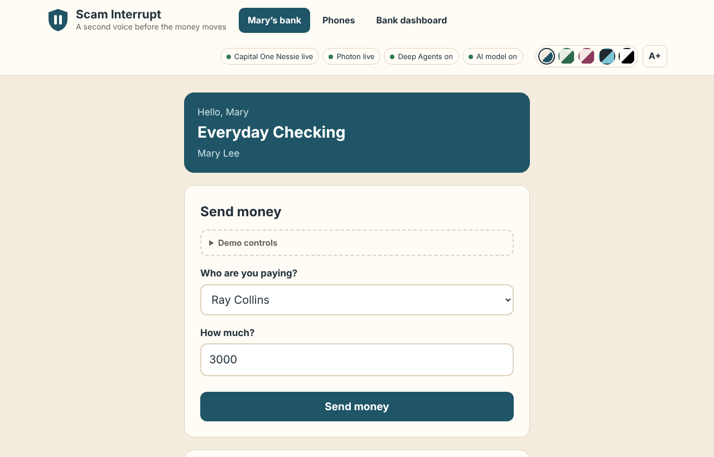
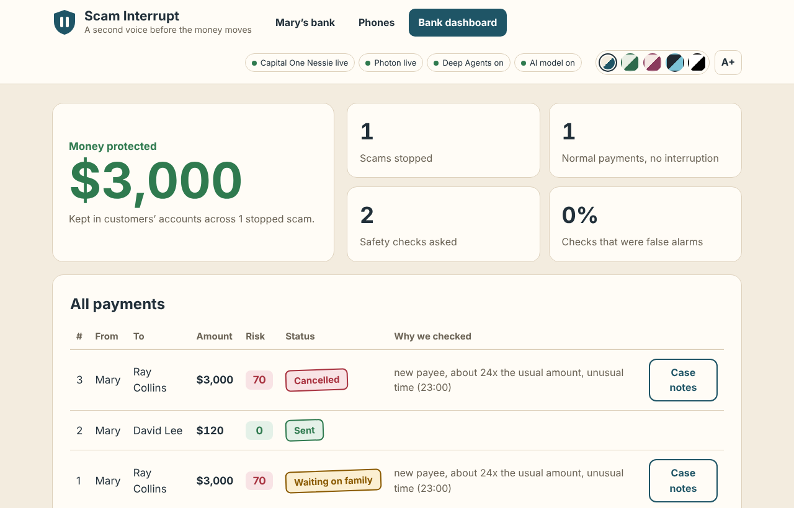
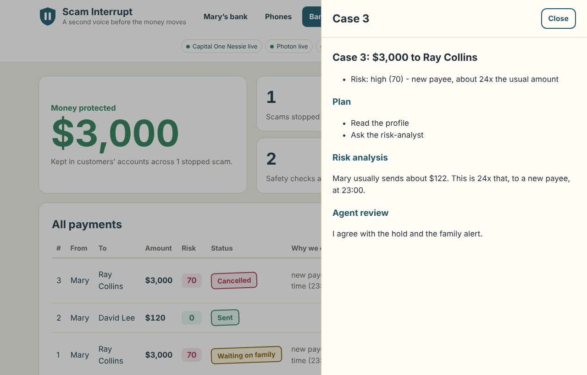
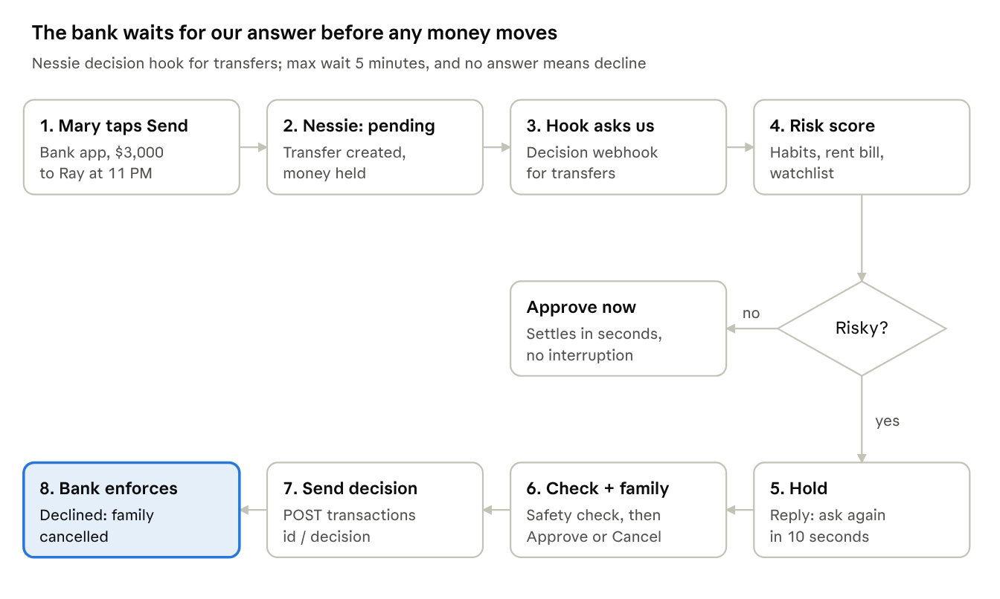
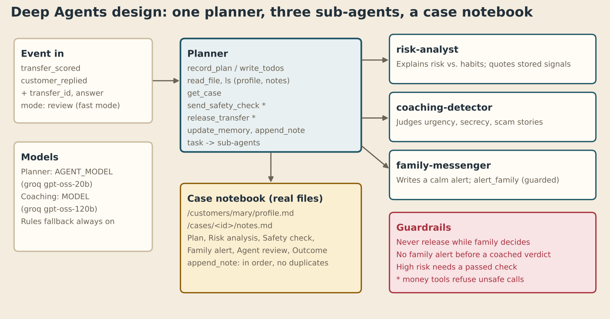

<p align="center"></p>

<h1 align="center">Scam Interrupt</h1>
<p align="center"><b>A second voice before the money moves.</b><br>
Most tools tell you after the money is gone. Scam Interrupt asks before it leaves.</p>

<p align="center"></p>

Scam Interrupt is an AI agent that **pauses risky bank transfers**, checks in with the customer in plain
words, **catches signs that a scammer is coaching them**, and brings an opted-in **trusted family member**
in before anything moves. Normal payments go straight through, and the customer always keeps the final say.

Built at **HackPrinceton Fall 2026** by Keerthana and Gayatri · Main track: **Business and Enterprise**

> **Starter scaffold note:** this repository began from an AI-generated starter scaffold. All project work
> happened during HackPrinceton (Nov 13–15, 2026); see the commit history.

---

## Contents
[The problem](#the-problem) · [What it does](#what-it-does) · [How we're different](#how-were-different) · [Screens](#screens) ·
[Architecture](#architecture) · [How the agent works](#how-the-agent-works) · [Tech stack](#tech-stack) ·
[Sponsor tools](#sponsor-tools) · [Design and accessibility](#design-and-accessibility) ·
[Run it](#run-it) · [Configuration](#configuration) · [API](#api) · [Project layout](#project-layout) ·
[Tests](#tests) · [Evaluation](#evaluation) · [Demo script](#demo-script) · [Troubleshooting](#troubleshooting) ·
[Challenges and what we learned](#challenges-and-what-we-learned) · [Privacy and safety](#privacy-and-safety) · [Team](#team)

---

## The problem
Scammers create panic ("your grandson is in jail," "your account is hacked"), then **coach their victims,
often older adults, on exactly what to tell the bank**. Bank fraud checks ask yes/no questions the victim has
already been told how to answer, and most protection tools alert family only **after** the money is gone.

## What it does
**Grandma Mary's story**, which is also our live demo:

1. A scammer texts Mary pretending to be her grandson, needing $3,000 for bail, and says to keep it secret.
2. Mary sends $3,000 in her bank app. **Scam Interrupt holds it.**
3. **Risk Scorer** explains the risk in Mary's own terms, using her Capital One Nessie data: new payee,
   about 24× her usual amount, 11 PM, and **"would leave $500, not enough for Rent ($1,200)."**
4. **Safety check** (iMessage via Photon): *"Did someone contact you and ask you to send this? Did they say it
   was urgent or secret?"* Mary answers vaguely: *"It's for my grandson."*
5. **Adaptive follow-up:** instead of a scripted question, the agent asks one question built from her own
   words: *"How do you know Ray Collins, and did you call your grandson back on the number you usually use?"*
   Mary: *"He called from a new number and said not to tell his mom. Ray is his lawyer."*
6. **Coaching Detector** (AI model + rules): secrecy, a new number, a third party collecting money → coached.
7. **Family alert:** David, her opted-in trusted contact, reads *"This looks like a **grandparent emergency
   scam**. Nothing has been sent yet. Ask Mary: did she call her grandchild back on their usual number?"* and
   taps **Approve** or **Cancel**.
8. David cancels. The transfer **never settles**, and Mary gets a short, kind explanation of the scam so she
   recognizes it next time. She can still tap **Send anyway**: the customer keeps the final say.
9. **Bank-wide watchlist:** Ray is now flagged for every customer. Anyone who tries to pay him gets
   *"payee linked to 1 stopped scam."*
10. In the background, the **Deep Agents** planner reviews the case and writes plain-English **case notes**.
    The dashboard shows **"Money protected: $3,000"** and **"Looks like: grandparent emergency scam."**

Clear answers skip the follow-up: obvious scam stories go straight to the family, and ordinary, specific
answers ("Rent for my apartment, same as every month") go straight through. A normal $120 payment to David at
2 PM is sent instantly with no messages.

<p align="center"></p>

## How we're different
Pieces of this exist; what's new is putting them **inside the payment itself**, automated, with the family
deciding.

| | Bank staff tools (e.g. Botminds) | Senior apps (e.g. OnGuardAI) | **Scam Interrupt** |
|---|---|---|---|
| Holds the money | Bank holds it, then staff call | No: outside the bank | **Yes: inside the payment (Nessie)** |
| Questions | Scripted for the fraud team | Alerts only | **Adaptive: built from her own story** |
| Who talks to the customer | A human fraud agent | Notifications | **Automated, in seconds, in her own iMessage** |
| Family's role | Not built in | Gets notified | **Decides with one tap; told what to ask** |
| Explains risk in her terms | Scam evidence | Call patterns | **Her own balance and bills** |
| Protects other customers | Per call | Per person | **Bank-wide payee watchlist** |
| Built for older adults | Staff software | Yes | **Low-vision font, high contrast, plain language** |

Researchers recommend exactly this layer: pausing a high-risk payment until a trusted contact confirms it,
for example before a first payment to a new payee
([Information, 2026](https://doi.org/10.3390/info17111065)).

## Screens

| Mary's bank | Phones (Mary and David) |
|---|---|
|  |  |
| **Bank dashboard** | **Agent case notes** |
|  |  |

**Five themes plus larger text** (Sand, Sage, Bloom, Dusk, High contrast):

<p align="center"></p>

## Architecture

<p align="center"></p>

- **Web UI** (plain HTML, CSS, JavaScript): Mary's bank app, the two phones, and the bank dashboard.
- **FastAPI backend:** receives transfers, safety-check replies, and family decisions, and serves the
  dashboard and case notes. Photon delivers real phone replies to `POST /webhooks/photon`.
- **Fast path (instant):** the proven pipeline makes every customer-facing decision in about a second, so Mary
  and David never wait on a slow model.
- **Deep Agents review (background):** after each step, a LangChain Deep Agents planner reviews the case with
  its sub-agents and writes case notes. Only one review runs at a time, so we stay within rate limits.
- **Backend services:** Capital One Nessie v2 (accounts and transfers), Photon 2.0 (iMessage), Groq (models),
  LangSmith (agent traces), and SQLite plus files (cases and notes).

**The key design rule:** a risky payment never settles until it's approved. Two ways to enforce it
(`NESSIE_HOLD`):
- **`app` (default):** our app holds the transfer and only posts it to Nessie after approval. A cancelled scam
  never reaches the bank.
- **`hook`:** the transfer is created in Nessie right away and the **bank itself waits for our answer**, using
  Nessie's **decision hooks**. We approve normal payments at once, ask Nessie to wait while Mary and David
  answer, then approve or decline with our reason recorded on the bank's transaction. If our service is
  unreachable, Nessie declines (fail safe).

<p align="center"></p>

## How the agent works

<p align="center"></p>

- **Planner:** gets one event (`transfer_scored` or `customer_replied`), writes a short plan
  (`record_plan` / `write_todos`), reads the customer's profile and the case notes from its file system, and
  delegates to sub-agents with the built-in `task` tool.
- **Sub-agents:**
  - **risk-analyst** explains why the transfer is risky compared with the customer's normal habits, quoting
    the stored signals.
  - **coaching-detector** runs or reviews the coaching verdict (urgency, secrecy, defensive denial, scam stories).
  - **family-messenger** writes a short, calm alert for the trusted contact.
  - **interviewer** reviews the adaptive follow-up: what it revealed and why a scammer couldn't script it.
- **Scam playbooks as files:** six playbooks (grandparent emergency, government impersonation, "safe account"
  bank impersonation, tech support, romance, prize) live in the agent's file system at `/playbooks/<type>.md`.
  The agent reads the matching one and names the scam in its notes.
- **Case notebook (real files):** `data/agent_fs/customers/<id>/profile.md` and
  `data/agent_fs/cases/<id>/notes.md`. Agents add sections with `append_note`, which keeps them in order and
  skips duplicates: Plan → Risk analysis → Safety check → Family alert → Agent review → Outcome.
  See [`docs/sample_case_notes.md`](docs/sample_case_notes.md).
- **Guardrails:** money-moving tools refuse unsafe calls. The agent can't release a transfer while the family
  is deciding, can't alert family before a coached verdict, and can't release a high-risk transfer without a
  passed safety check.
- **Two modes:** `AGENT_BACKGROUND=true` (default) acts instantly and runs the agent as a background
  reviewer; `AGENT_BACKGROUND=false` lets the planner make the decisions itself (slower).
- **Traces:** every run appears in LangSmith as `scam-interrupt:<event>-review`.

## Safety checks in detail
**Risk Scorer** (`backend/risk.py`), each reason shown to the customer and the bank:
- new payee; amount far above her usual (learned from her Nessie transaction history); unusual hour;
  gift card or crypto merchant
- **more than her available balance**, or **would leave too little for an upcoming bill** (Nessie bills)
- **payee linked to a stopped scam** (bank-wide watchlist built from cancelled cases)

**Coaching Detector + adaptive follow-up** (`backend/coaching.py`, `backend/followup.py`):
- The first answer is judged **coached**, **calm**, or **unclear** by the AI model, with a rules safety net
  (urgency, secrecy, defensive denial, scam stories, how well she knows the payee).
- **Unclear** → one follow-up question from her own words and the matching scam playbook. It never asks for
  passwords, codes or account numbers, and never accuses.
- Still unclear after the follow-up → treated as coached, and the family decides.

**Scam playbooks** (`backend/playbooks.py`): name the scam in the family alert, tell the family what to ask,
and send Mary a short explanation after a cancel.

## Tech stack

**Backend.** Python 3 with **FastAPI** and **Uvicorn** for the web server, **SQLite** for customers,
transfers, safety checks, alerts, habits and messages, and **requests** for calling external APIs.
Configuration comes from a `.env` file through python-dotenv.

**AI and agents.** **LangChain** with the **Deep Agents** library (`deepagents`, built on LangGraph) for
the planner, sub-agents, planning and file system. Models run on **Groq**: `openai/gpt-oss-120b` for the
Coaching Detector and `openai/gpt-oss-20b` for the planner, so each uses its own quota. The Coaching
Detector asks the model for JSON and always keeps a **rule-based safety net**, so the demo works even if the
model is slow or unavailable. **LangSmith** records every agent run as a trace.

**Banking.** **Capital One Nessie v2**: Bearer-token auth, amounts in cents, `POST /data/seed` for a ready-made
demo bank, customers and accounts (Ray is his own customer), deposits, **bills**, **balances**, **transaction
history**, and **decision hooks** (`POST /webhooks` with `mode: decision`, `POST /transactions/{id}/decision`). An offline **mock Nessie** with the same interface lets us build and demo without Wi-Fi.

**Messaging.** **Photon 2.0** sends the safety check and the family alert as iMessages and delivers replies
to our webhook (exposed with a tunnel such as ngrok during development). An on-screen **phone simulator**
mirrors every message.

**Frontend.** Plain **HTML, CSS and JavaScript**, with no build step. Themes use CSS variables; the font is
**Atkinson Hyperlegible**; preferences are remembered in the browser.

**Testing and tooling.** Offline tests with the mock bank, a simulated Nessie v2 server, and a fake agent.
We built with **Claude Code**, connected to **ChatOverflow** so our coding agents shared what they learned.

## Sponsor tools

| Sponsor | How we use it |
|---|---|
| **Capital One Nessie** | Balances, bills and transaction history explain the risk in Mary's terms; a bank-wide payee watchlist; decision hooks let the bank itself hold and decline a scam transfer |
| **Photon 2.0** | The safety check, the adaptive follow-up conversation, and the family alert run over iMessage (`photon-bridge/`, built with the Spectrum SDK) |
| **LangChain Deep Agents** | Planner, four sub-agents, planning tool, file system (case notebook + scam playbooks), guardrailed tools; traced in LangSmith |
| **Amazon (Best Practical AI)** | A practical agent that reasons, acts on real transactions, and adapts to each customer's habits |
| **ChatOverflow** | Our coding agents were connected while we built |

## Design and accessibility
Our users are often older adults, so the product is designed to be easy to read and calm to use:
- **Atkinson Hyperlegible**, a font designed by the Braille Institute for readers with low vision, at an 18px base.
- Buttons at least 52px tall, large form fields, and plain-language statuses such as
  *"Paused: please answer our message"* and *"Cancelled: nothing was sent."*
- **Five themes:** Sand (default), Sage, Bloom, Dusk (dark), and **High contrast**, plus an **A+** button that
  enlarges everything by about 15%.
- Visible keyboard focus and reduced-motion support.
- Mary's screen is one simple column; demo shortcuts are tucked into a collapsed **Demo controls** section.
- Brand: a shield with a pause symbol (we pause the payment), and the tagline
  *"A second voice before the money moves."* See [`docs/BRAND.md`](docs/BRAND.md).

## Run it

### Offline (about 2 minutes, no keys)
```bash
python3 -m venv .venv && source .venv/bin/activate
pip install -r requirements.txt
cp .env.example .env              # NESSIE_MODE=mock, PHOTON_MODE=sim, rules only
python -m backend.seed            # Mary, David, the scam payee, merchants, history
uvicorn backend.app:app --reload --reload-dir backend --reload-dir web --port 8000
```
Open **http://localhost:8000** → Mary's bank → **Demo controls** → "Scam: $3,000 to Ray at 11 PM" → Phones →
reply as Mary → tap **Cancel** as David → Bank dashboard.

### Live
1. **Nessie v2:** get a key at v2.nessieisreal.com. Set `NESSIE_MODE=live`, `NESSIE_KEY`, and `NESSIE_URL`,
   then run `python -m backend.seed` once. (It calls `POST /data/seed` and labels three accounts as Mary,
   David and Ray.)
2. **Photon 2.0:** set `PHOTON_MODE=live`, `PHOTON_API_KEY`, and the demo phone numbers **before** seeding.
   If replies arrive by webhook, expose `POST /webhooks/photon` on a public URL (for example `ngrok http 8000`).
3. **Models (Groq):** `pip install langchain-groq`; set `MODEL`, `AGENT_MODEL` and `GROQ_API_KEY`.
4. **Deep Agents + LangSmith:** set `AGENT_MODE=deepagents`, `AGENT_BACKGROUND=true`,
   `LANGSMITH_TRACING=true`, `LANGSMITH_API_KEY`, `LANGSMITH_PROJECT=scam-interrupt`.

5. **Follow-up question:** on by default (`FOLLOW_UP=true`).
6. **Nessie decision hooks (optional):** with ngrok running, register the hook once:
   ```bash
   python -m scripts.register_nessie_hook https://<your-id>.ngrok-free.app
   ```
   Put the printed `NESSIE_HOOK_SECRET` in `.env`, set `NESSIE_HOLD=hook`, and restart. Set `NESSIE_HOLD=app`
   to go back. See [`docs/UPGRADES.md`](docs/UPGRADES.md).

The home page shows chips for what's running: Nessie, Photon, Deep Agents, and the AI model.

## Configuration

| Variable | Example | Meaning |
|---|---|---|
| `NESSIE_MODE` | `live` | `mock` (offline) or `live` (Nessie v2) |
| `NESSIE_KEY` | `sk_…` | Nessie v2 key (Bearer token) |
| `NESSIE_URL` | `https://v2-prod-api.nessieisreal.com` | Nessie v2 base URL |
| `PHOTON_MODE` | `live` | `sim` (on-screen phones) or `live` (Photon 2.0) |
| `PHOTON_API_KEY` | | Photon 2.0 key |
| `MODEL` | `groq:openai/gpt-oss-120b` | Model for the Coaching Detector; empty = rules only |
| `AGENT_MODEL` | `groq:openai/gpt-oss-20b` | Model for the Deep Agents planner (defaults to `MODEL`) |
| `GROQ_API_KEY` | | Groq key |
| `AGENT_MODE` | `deepagents` | `pipeline` or `deepagents` |
| `AGENT_BACKGROUND` | `true` | `true`: act instantly, review in background; `false`: agent decides |
| `LANGSMITH_TRACING` / `LANGSMITH_API_KEY` / `LANGSMITH_PROJECT` | `true` / … / `scam-interrupt` | Agent traces |
| `FOLLOW_UP` | `true` | Ask one adaptive follow-up when the first answer is unclear |
| `NESSIE_HOLD` | `app` | `app`: our app holds risky transfers; `hook`: Nessie holds them and asks us |
| `NESSIE_HOOK_SECRET` | | Signing secret printed by `scripts.register_nessie_hook` |
| `PUBLIC_URL` | `https://….ngrok-free.app` | Public URL for Photon and Nessie webhooks |
| `MARY_PHONE` / `DAVID_PHONE` | `+1…` | Demo phones (teammates, with consent); saved at seed time |
| `DB_PATH` | `data/scam_interrupt.db` | SQLite file |

Never commit `.env`; it's in `.gitignore`.

## API

| Method | Path | Purpose |
|---|---|---|
| GET | `/api/health` | Modes in use (Nessie, Photon, agent, model) |
| POST | `/api/demo/reset` | Wipe and re-seed (creates a new Nessie demo bank in live mode) |
| GET | `/api/payees?customer_id=mary` | People and merchants Mary can pay |
| POST | `/api/transfers` | Request a transfer `{customer_id, payee_id, amount, hour?}` |
| GET | `/api/transfers` | All transfers |
| GET | `/api/cases/{id}` | Full case: transfer, customer, check, alert |
| POST | `/api/cases/{id}/reply` | Customer's safety-check answer `{text}` |
| POST | `/api/cases/{id}/family` | Trusted contact's decision `{decision: approve or cancel}` |
| POST | `/api/cases/{id}/override` | Customer's "Send anyway" |
| GET | `/api/cases/{id}/notes` | The agent's case notes (markdown) |
| GET | `/api/phone/{owner_id}` | Messages for the phone simulator |
| GET | `/api/dashboard` | Money protected, scams stopped, false-alarm rate, flagged payees, all transfers |
| POST | `/webhooks/photon` | Inbound Photon messages |
| POST | `/webhooks/nessie-decision` | Nessie decision hook (signed); approve, decline, or "ask again later" |

Interactive docs: **http://localhost:8000/docs**

## Project layout
```
scam-interrupt/
├── backend/
│   ├── app.py              FastAPI routes, Photon webhook, case notes
│   ├── pipeline.py         case flow as small tools (fast path)
│   ├── agent.py            Deep Agents planner, 3 sub-agents, case notebook, guardrails, fast mode
│   ├── risk.py             Risk Scorer rules
│   ├── coaching.py         Coaching Detector (LLM JSON + rules safety net)
│   ├── followup.py         adaptive follow-up: coached / calm / unclear, one personalized question
│   ├── playbooks.py        six scam playbooks: name, what family should ask, tip for the customer
│   ├── nessie_hooks.py     Nessie decision hooks (signature check, approve / decline / wait)
│   ├── memory.py           customer habits from Nessie history (+ baseline)
│   ├── nessie.py           Capital One Nessie v2 client + offline mock
│   ├── messaging.py        message log; sends through Photon in live mode
│   ├── photon_adapter.py   Photon 2.0 integration
│   ├── seed.py             demo data (mock or Nessie /data/seed)
│   ├── db.py, config.py
├── photon-bridge/          TypeScript bridge to Photon (Spectrum SDK) for iMessage
├── web/                    index, bank, phones, dashboard, style.css, nav.js, logo.svg
├── scripts/                try_coaching.py, eval_coaching.py, register_nessie_hook.py
├── tests/                  test_core, test_agent, test_nessie_v2, test_followup, test_hooks
├── apply_upgrades.py       one-time patcher used to add the upgrades (safe to re-run)
├── docs/                   images, sample case notes, brand, playbook, demo script
├── requirements.txt
└── .env.example
```

## Tests
```bash
python -m tests.test_core        # full demo flow, offline (incl. bill and watchlist reasons)
python -m tests.test_followup    # adaptive follow-up, scam playbooks, teaching message
python -m tests.test_hooks       # Nessie decision hooks: approve, decline, wait, signature
python -m tests.test_agent       # Deep Agents wiring, guardrails, fast mode (fake agent)
python -m tests.test_nessie_v2   # live mode against a simulated Nessie v2
```
All 22 tests run offline, with no keys.

## Evaluation
```bash
python -m scripts.eval_coaching      # writes docs/eval_results.md
```
On our own **30-answer test set** (20 clear answers, 10 vague answers with a second reply):

| Metric | Result |
|---|---|
| Scams caught | **15 / 15** |
| False alarms (ordinary payments sent to family) | **1 / 15** |
| Overall accuracy | **29 / 30 (96%)** |
| Follow-up asked | 5 of 15 scams, 7 of 15 ordinary payments |

**Honest notes:** this is our own small test set, not real-world data; the run used the AI model with the rules
safety net (Groq rate limits sent part of it to the rules); and the rules were developed against these same
cases. We're adding answers written independently by a teammate for a fairer score. See
[`docs/eval_results.md`](docs/eval_results.md) for every case.

## Demo script
1. **Hook:** "Scammers coach older adults on exactly what to tell the bank."
2. **Live scam:** a judge plays Mary and sends $3,000 to Ray at 11 PM. Point at the reasons, including
   *"not enough for rent."*
3. **Follow-up:** the judge answers vaguely ("It's for my grandson") and gets a question they didn't expect.
4. **Family loop:** David's phone reads "This looks like a grandparent emergency scam" with what to ask; he taps
   **Cancel**. Mary gets a short explanation.
5. **Network effect:** try $50 to Ray: flagged as "linked to 1 stopped scam."
6. **Impact:** dashboard "$3,000 protected," **Case notes**, the LangSmith trace, and (hook mode) the declined
   transaction in Nessie with our reason.
7. **Accessibility:** switch to **High contrast** and press **A+**.
8. **Close:** "Most tools tell you after the money is gone. Scam Interrupt asks before it leaves."

## Troubleshooting

| Problem | Fix |
|---|---|
| `command not found: python` | Run `source .venv/bin/activate` in each new terminal |
| `Address already in use` | `lsof -ti :8000 \| xargs kill`, then start again |
| Server restarts while the agent runs | Start with `--reload-dir backend --reload-dir web` |
| Status line says "Fixed pipeline" | Only one `AGENT_MODE=deepagents` line in `.env`; fully restart the server |
| Groq `429` rate limit (per minute or per day) | Use separate `MODEL` and `AGENT_MODEL`; `AGENT_MODE=pipeline` while rehearsing; or upgrade the Groq plan |
| Agent calls a tool it doesn't have | Fixed with `write_todos` / `record_plan` tools and "only call tools you have been given" |
| Phone replies don't match | Phone numbers are saved at seed time; they must match Photon's format exactly |
| Nessie errors | Check `NESSIE_KEY` and `NESSIE_URL` (v2), or switch to `NESSIE_MODE=mock` |
| Approve fails with "insufficient funds" | Re-run `python -m backend.seed` (tops Mary's checking up to $3,500) |
| Decision hook never called | ngrok must be running and registered: re-run `scripts.register_nessie_hook` with the current URL |
| Anything goes wrong with hooks | Set `NESSIE_HOLD=app` and restart; `git checkout demo-safe` returns to the last known-good version |

## Challenges and what we learned
- **Nessie v2 changed:** the old API host was unreachable, and v2 uses Bearer tokens, cents, and
  `/data/seed`. We rewrote the client and added a mock so we were never blocked.
- **Model choice:** one model was retired for new users and another was too slow for a live demo, so we
  moved to Groq and kept a rules safety net.
- **Agents are slow and rate-limited:** running deepagents inline took up to 2 minutes on a free tier. The
  fix was architectural: act instantly with the proven pipeline, and run the agent as a background reviewer.
- **Nessie was richer than we expected:** its OpenAPI spec revealed bills, balances and decision hooks, which
  let us explain risk in the customer's own terms and move the hold inside the bank.
- **Scripts are the weakness of every fraud check:** coached victims answer scripted questions perfectly, so we
  made the check adaptive, with one question built from the customer's own story.
- **Making agent output trustworthy:** a dedicated `append_note` tool, duplicate checks, and prompts that
  quote stored signals turned messy notes into clean case files a bank could read.

## Privacy and safety
- Mock bank data only; no real customer data.
- Demo phones belong to teammates, used with their consent.
- Family alerts require the customer's prior opt-in.
- The customer can always send a held payment anyway. Scam Interrupt adds a pause and a second voice,
  nothing more.

## What's next
A pilot with a local credit union, voice safety calls, false-alarm tracking over time, and more scam patterns.

## Team
- **Keerthana Devi Govindaraj** ([@KeerthanaDeviGovindaraj](https://github.com/KeerthanaDeviGovindaraj)):
  agent and bank (Nessie v2, Risk Scorer, Coaching Detector, Deep Agents planner)
- **Gayatri Sawant:** Photon and demo (safety check, family alert, bank app, dashboard, pitch)
